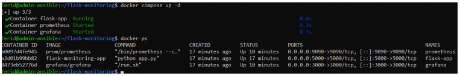
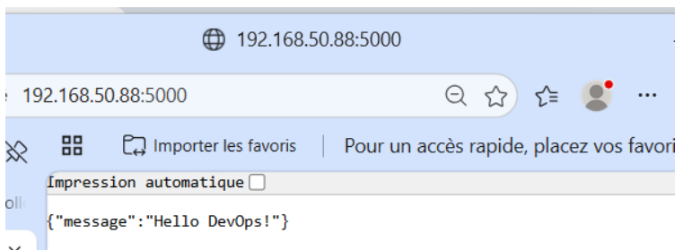
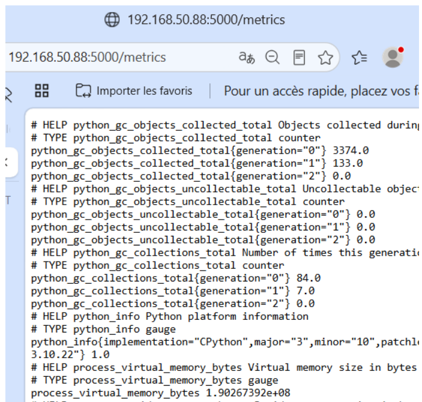
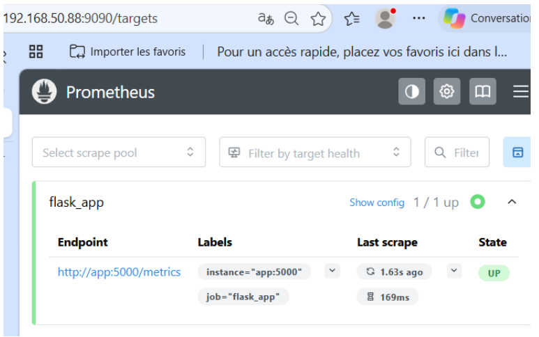
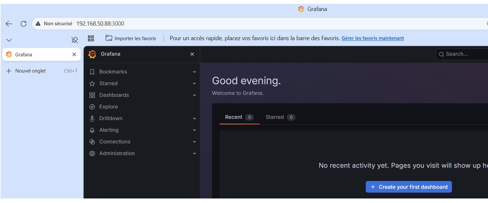
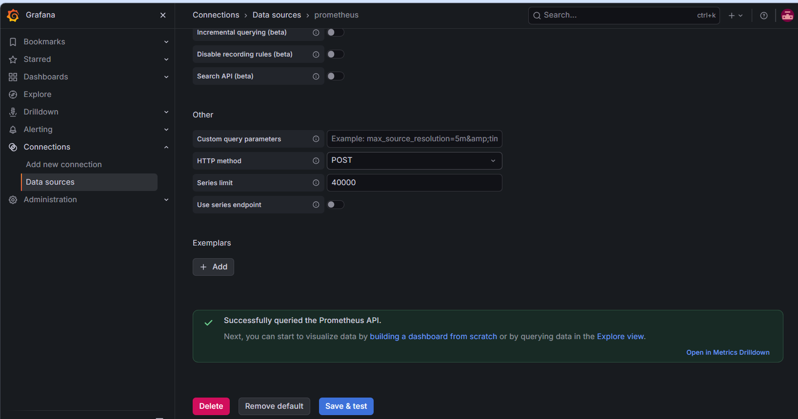
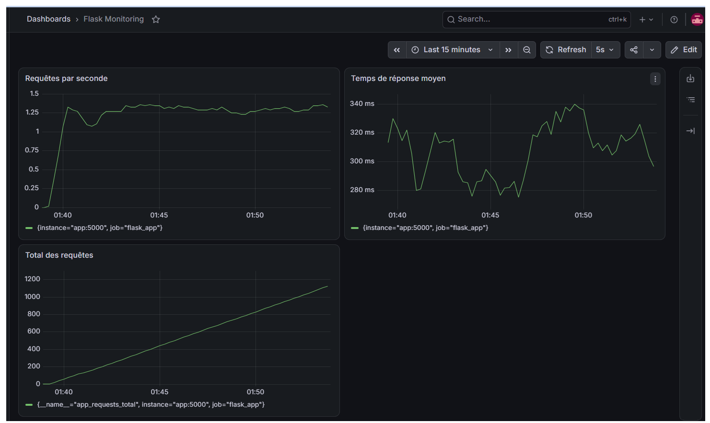

# Monitoring d'une application Flask avec Prometheus et Grafana

**ISET Tozeur – Master DevOps & Cloud 2 – Disponibilité des Infrastructures**

Auteur : Ferid Saad

## Objectif

Mettre en place un monitoring complet d'une application web simple (Flask) afin d'observer :

- ses métriques internes (temps de réponse, requêtes traitées) ;
- son état dans **Prometheus** ;
- ses indicateurs dans un dashboard **Grafana**.

## Architecture


| Service | Image | Port | Rôle |
|---|---|---|---|
| app | build local (python:3.10-slim) | 5000 | Application Flask + endpoint `/metrics` |
| prometheus | prom/prometheus | 9090 | Collecte et stockage des métriques |
| grafana | grafana/grafana | 3000 | Visualisation (dashboard) |

## Structure du projet

```
flask-monitoring/
├── app.py
├── Dockerfile
├── docker-compose.yml
├── prometheus.yml
├── screenshots/
└── README.md
```


## Étape 1 : Créer le répertoire du projet

```bash
mkdir flask-monitoring && cd flask-monitoring
git init
```

## Étape 2 : Créer l'application Flask (`app.py`)

```bash
git add app.py
git commit -m "step 2: ajout de l'application Flask avec métriques Prometheus"
```

## Étape 3 : Créer le Dockerfile

```dockerfile
FROM python:3.10-slim
WORKDIR /app
COPY app.py .
RUN pip install flask prometheus_client
EXPOSE 5000
CMD ["python", "app.py"]
```

## Étape 4 : Créer le `docker-compose.yml`

Le fichier déclare trois services : `app`, `prometheus` et `grafana`.


## Étape 5 : Créer `prometheus.yml`

```yaml
global:
  scrape_interval: 5s

scrape_configs:
  - job_name: 'flask_app'
    static_configs:
      - targets: ['app:5000']
```

## Étape 6 : Lancer la stack

```bash
docker compose up -d
docker ps
```

Résultat attendu : 3 conteneurs en cours d'exécution (app, prometheus, grafana).



## Étape 7 : Tester l'application

| Service | URL |
|---|---|
| Application | http://localhost:5000 |
| Métriques | http://localhost:5000/metrics |
| Prometheus | http://localhost:9090 |
| Grafana | http://localhost:3000 |

Vérification de la cible Prometheus : **Status → Targets** → `flask_app` doit être **UP**.



-----------------------------------------



-----------------------------------------



-----------------------------------------



## Étape 8 : Créer le dashboard Grafana

**a) Source de données** : Connections → Data sources → Add data source → Prometheus.
URL : `http://prometheus:9090` → *Save & test*.

**b) Nouveau dashboard** avec trois panneaux :

| Panneau | Requête PromQL |
|---|---|
| Requêtes par seconde | `rate(app_requests_total[1m])` |
| Temps de réponse moyen | `rate(app_request_latency_seconds_sum[1m]) / rate(app_request_latency_seconds_count[1m])` |
| Total des requêtes | `app_requests_total` |






Le dashboard exporté (Share → Export → JSON) est sauvegardé dans `grafana-dashboard.json`.


## Étape 9 : Tester le monitoring

Génération de trafic :

```bash
while true; do curl -s http://localhost:5000/ > /dev/null; sleep 0.2; done
```

Les compteurs augmentent dans Prometheus et dans Grafana. La latence moyenne observée est d'environ 0,3 s,
ce qui correspond au délai aléatoire simulé (0,1 à 0,5 s).

📸 `screenshots/09-grafana-trafic.png`

---

## Problèmes rencontrés

| Problème | Cause | Solution |
|---|---|---|
| `Bind for 0.0.0.0:9090 failed: port is already allocated` | Un ancien conteneur Prometheus utilisait déjà le port 9090 | `docker stop <nom>` puis `docker compose up -d` |

## Commandes utiles

```bash
docker compose ps          # état des services
docker compose logs -f     # logs
docker compose down        # arrêt et suppression des conteneurs
```

## Conclusion

Ce TP a permis de :

- instrumenter une application Flask avec `prometheus_client` ;
- collecter ses métriques avec Prometheus ;
- les visualiser dans un dashboard Grafana (débit, latence moyenne, total des requêtes).
